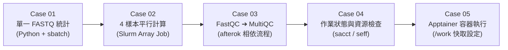

# 第 03 章：基礎 Slurm 作業與品質檢查 (Case 01 ~ Case 05)

在 Antigravity 開啟 `/work/$USER/nano4-ngs-slurm-skill` 資料夾後，AI Agent 會自動讀取 `AGENTS.md` 規範與 `nano4-ngs-slurm` 技能。

本章使用 `data/fastq_4samples/` 內的 **4 個輕量 FASTQ 樣本**，依序示範 5 個基礎排程與品管工作。您只需複製下方提示詞貼給 AI Agent，待 AI 說明預計使用的計畫與資源配置後，回覆 **`同意派送`** 即可協同執行。



---

## 練習 1 (`tutorial/case01`)：單一 FASTQ 檔案統計（單一作業）

### 📋 複製貼給 AI Agent 的指令：

```text
請幫我建立並送出一個簡單的 FASTQ 統計工作：
1. 寫一支 Python 程式，讀取 data/fastq_4samples/FMT.0093C_5_L001_R1_001.fastq.gz，算出裡面有幾條 reads、平均讀長和 GC 含量 %。
2. 幫我寫 Slurm 腳本送到計算節點去跑（用課程計畫 GOV115088）。
3. 腳本放在目前目錄 tutorial/case01
4. 送出前先跟我說你的設定，跑完後把結果整理給我。
```

- **協同執行內容**：AI Agent 會在 `tutorial/case01/` 建立 `fastq_stat.py` 與符合 `ngs62g`（8 核心、62G 記憶體）的 Slurm 腳本，確認後派送至計算節點，並回報統計結果（總 Reads 數 `1,000` 條、平均讀長 `222.05 bp`、GC 含量 `53.01%`）。

---

## 練習 2 (`tutorial/case02`)：多樣本平行計算（批次陣列作業 Array Job）

### 📋 複製貼給 AI Agent 的指令：

```text
data/fastq_4samples/ 資料夾裡面有 4 個定序樣本（.fastq.gz），請幫我用 Slurm 陣列作業（Array Job）同時算出每個樣本各有幾條 reads，送出前先給我看計畫。
腳本放在目前目錄 tutorial/case02
```

- **協同執行內容**：AI Agent 會建立 `--array=1-4%4` 的 Slurm 陣列腳本，同時平行處理 4 個樣本，完成後彙整各樣本的 Reads 數量表。

---

## 練習 3 (`tutorial/case03`)：FastQC 與 MultiQC 品質檢查流程（相依作業 Dependency）

### 📋 複製貼給 AI Agent 的指令：

```text
請幫我對 data/fastq_4samples/ 裡面的 4 個樣本做品質檢查流水線：
- 第一步：用 FastQC 檢查這 4 個樣本的品質，結果放在 qc/fastqc_out/。
- 第二步：等第一步確定成功跑完後，自動啟動 MultiQC 把結果彙整成一份 HTML 報告，放在 qc/multiqc_out/。
- 先告訴我你打算怎麼送，我同意後再送出。
- 腳本放在目前目錄 tutorial/case03
```

- **協同執行內容**：透過 `sbatch --parsable` 與 `--dependency=afterok:<JOB_ID>` 串接兩階段作業。當第一階段 4 個 FastQC 陣列任務全部成功後，Slurm 自動啟動 MultiQC 產出 `qc/multiqc_out/multiqc_report.html`。

---

## 練習 4 (`tutorial/case04`)：檢查作業狀態與資源使用率（`sacct` / `seff`）

### 📋 複製貼給 AI Agent 的指令：

```text
剛剛送出去的工作跑完了嗎？如果跑完了，請幫我檢查資源使用率與執行時間，並用白話文跟我說跑得順不順、這 4 個樣本的品質結果如何。
結果報告放置於 tutorial/case04
```

> [!TIP]
> **常見問題：為什麼執行 `squeue -u $USER` 沒看到作業？**
> `squeue` 僅顯示「排隊中 (`PD`)」或「執行中 (`R`)」的作業。因為範例 FASTQ 檔案較小（每檔 1,000 reads），計算節點約 **8 秒** 即完成所有分析並離開佇列。若要查詢已完成的作業紀錄，可使用 `sacct -u $USER -S today`。

---

## 練習 5 (`tutorial/case05`)：使用 Apptainer 容器執行並設定 `/work` 快取

### 📋 複製貼給 AI Agent 的指令：

```text
以下的內容會用到 apptainer 下載 image，但 home 目錄空間有限，是否補充 cache 在 /work/$USER/？

這次不要用 module load，請改寫一個用 Apptainer 容器執行的 Slurm 工作：
1. 在計算節點直接從 Docker Hub 下載 multiqc/multiqc:v1.35 映像檔，.sif 檔請存在我的 /work/$USER/containers/。
2. 用這個容器去掃描剛剛 qc/fastqc_out/ 的結果，產生 MultiQC 報告。
3. 腳本報告放在目前目錄 tutorial/case05
```

- **協同執行內容**：
  1. 在腳本中設定 `APPTAINER_CACHEDIR="/work/${USER}/.apptainer/cache"` 與 `APPTAINER_TMPDIR`，避免容器解包暫存檔佔用 `/home` 配額。
  2. 在計算節點拉取 `multiqc_1.35.sif` 並執行 MultiQC 報告彙整。

---

👉 完成後，請進入 **[第 04 章：QIIME 2 腸道菌相分析](../04-qiime2-microbiome-pipeline/README.md)**。
