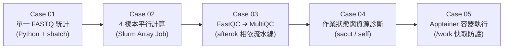

# 第 03 章：基礎實戰 —— 用自然語言跑 Slurm 排程與生醫質控 (Case 01 ~ Case 05)

當您在 Antigravity 開啟了 `/work/$USER/nano4-ngs-slurm-skill` 資料夾後，AI 已經自動讀懂了 `AGENTS.md` 與 `nano4-ngs-slurm` 技能。

您**不需要死背 `#SBATCH` 參數**，只要依序將下方 **5 個練習框內的文字直接複製貼給右側的 AI**，並在 AI 向您報告設定後回覆 **`同意派送`** 即可！



---

## 練習 1 (`tutorial/case01`)：統計單一真實樣本的基礎數據（單一作業）

### 📋 請複製以下 Prompt 貼給 AI：

```text
請幫我建立並送出一個簡單的 FASTQ 統計工作：
1. 寫一支 Python 程式，讀取 data/fastq_4samples/FMT.0093C_5_L001_R1_001.fastq.gz，算出裡面有幾條 reads、平均讀長和 GC 含量 %。
2. 幫我寫 Slurm 腳本送到計算節點去跑（用課程計畫 GOV115088）。
3. 腳本放在目前目錄 tutorial/case01
4. 送出前先跟我說你的設定，跑完後把結果整理給我。
```

- **AI 會幫您做什麼**：自動在 `tutorial/case01/` 寫出 `fastq_stat.py` 與符合 `ngs62g`（8 核心、62G 記憶體）的 Slurm 腳本，先向您確認設定，獲同意後送出並回報：**總 Reads 數 `1,000` 條、平均讀長 `222.05 bp`、GC 含量 `53.01%`**。

---

## 練習 2 (`tutorial/case02`)：多個定序樣本同時平行算條數（批次陣列作業 Array Job）

### 📋 請複製以下 Prompt 貼給 AI：

```text
data/fastq_4samples/ 資料夾裡面有 4 個定序樣本（.fastq.gz），請幫我用 Slurm 陣列作業（Array Job）同時算出每個樣本各有幾條 reads，送出前先給我看計畫。
腳本放在目前目錄 tutorial/case02
```

- **AI 會幫您做什麼**：自動建立 `--array=1-4%4` 的 Slurm 陣列腳本，讓計算節點同時平行處理 4 個檔案，並在完成後把 4 個樣本各自的 Reads 數量整理成表格給您。

---

## 練習 3 (`tutorial/case03`)：做完 FastQC 接著自動跑 MultiQC（前後相依流水線 Dependency）

### 📋 請複製以下 Prompt 貼給 AI：

```text
請幫我對 data/fastq_4samples/ 裡面的 4 個樣本做品質檢查流水線：
- 第一步：用 FastQC 檢查這 4 個樣本的品質，結果放在 qc/fastqc_out/。
- 第二步：等第一步確定成功跑完後，自動啟動 MultiQC 把結果彙整成一份 HTML 報告，放在 qc/multiqc_out/。
- 先告訴我你打算怎麼送，我同意後再送出。
- 腳本放在目前目錄 tutorial/case03
```

- **AI 會幫您做什麼**：利用 `sbatch --parsable` 與 `--dependency=afterok:<JOB_ID>` 串接兩階段作業。當第一階段 4 個 FastQC 陣列子任務全部成功（ExitCode `0:0`）後，Slurm 會自動解鎖並啟動 MultiQC，產出 `qc/multiqc_out/multiqc_report.html`。

---

## 練習 4 (`tutorial/case04`)：檢查工作跑完了沒，並看資源與品質結果（`sacct` / `seff` 診斷）

### 📋 請複製以下 Prompt 貼給 AI：

```text
剛剛送出去的工作跑完了嗎？如果跑完了，請幫我檢查資源使用率與執行時間，並用白話文跟我說跑得順不順、這 4 個樣本的品質結果如何。
結果報告放置於 tutorial/case04
```

> [!TIP]
> **常見問題：為什麼我在終端機打 `squeue -u $USER` 沒看到剛剛派出的工作？是機器不對嗎？**
> 不是機器不對！因為 `squeue` 只會顯示「正在排隊 (`PD`)」或「正在跑 (`R`)」的即時工作。由於練習用的 4 個 FASTQ 很小（每檔 1,000 reads），計算節點**只花 2 秒就跑完 FastQC、6 秒跑完 MultiQC**，總共 8 秒就結束並離開 `squeue` 了！要看已經跑完的歷史工作，請用 `sacct -u $USER -S today`。

---

## 練習 5 (`tutorial/case05`)：不載入系統模組，改用 Apptainer 容器執行並保護家目錄配額

### 📋 請複製以下 Prompt 貼給 AI：

```text
以下的內容會用到 apptainer 下載 image，但 home 目錄空間有限，是否補充 cache 在 /work/$USER/？

這次不要用 module load，請改寫一個用 Apptainer 容器執行的 Slurm 工作：
1. 在計算節點直接從 Docker Hub 下載 multiqc/multiqc:v1.35 映像檔，.sif 檔請存在我的 /work/$USER/containers/。
2. 用這個容器去掃描剛剛 qc/fastqc_out/ 的結果，產生 MultiQC 報告。
3. 腳本報告放在目前目錄 tutorial/case05
```

- **AI 會幫您做什麼**：
  1. 自動在腳本中加入 `export APPTAINER_CACHEDIR="/work/${USER}/.apptainer/cache"` 與 `APPTAINER_TMPDIR`，將下載過程產生的 **1.2 GB 暫存檔** 全部導向 `/work`，完全不消耗 `/home` 寶貴的 100 GB 空間。
  2. 在計算節點直連外網拉取 `multiqc_1.35.sif` 並完成報告彙整。

---

👉 熟悉基礎排程後，請進入 **[第 04 章：進階實戰 —— 四輪對話完成 QIIME 2 腸道菌相完整分析](../04-qiime2-microbiome-pipeline/README.md)**！
