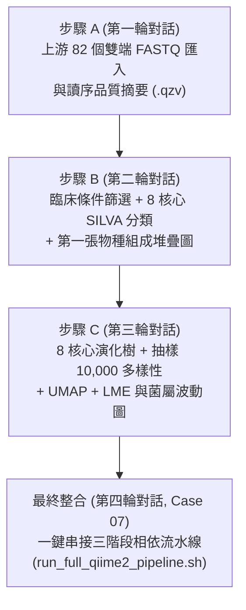

# 第 04 章：進階實戰 —— 四輪對話完成 QIIME 2 腸道菌相完整分析 (Case 06 ~ Case 07)

在本章中，我們將挑戰真實臨床試驗（**NCT02269150：異體造血幹細胞移植病患接受自體糞菌移植 auto-FMT 之腸道菌相追蹤研究**）的完整 16S rRNA 分析流程。

所有需要的 **82 個雙端 `.fastq.gz` 原始定序檔、臨床 Metadata、預訓練 SILVA 138.2 分類器與特徵表** 都已經內建在專案的 `data/qiime2/` 目錄中！您不需要手動修改 500 行的腳本，也不用跑 `wget` 下載，只要照順序複製貼上以下 **4 輪對話 Prompt** 即可完成整套研究級分析：



---

## 🔹 步驟 A（第一輪對話）：上游 82 個雙端 FASTQ 匯入與品質評估 (`Upstream`)

### 📋 請複製以下 Prompt 貼給 AI：

```text
請參考 data/qiime2/Qiime2_Pipeline.sh 的第一段（上游前處理），幫我寫一支 Slurm 作業（計畫 GOV115088）送到計算節點執行，輸出結果請放在 tutorial/case06/qiime2_run/Upstream/：

1. 載入 biology/qiime2/2026.7 模組（不用再跑 wget 下載，資料已經在 data/qiime2/ 裡面了）。
2. 把 data/qiime2/Input_Data/data_to_import/ 裡面的 82 個雙端 FASTQ 檔案匯入成 demultiplexed-sequences.qza，並產生品質摘要圖 demultiplexed-sequences-summ.qzv。
3. 直接讀取現成的 data/qiime2/Upstream/feature-table-0.qza，產出特徵表摘要統計 feature-table-0-summ.qzv。
```

> [!NOTE]
> **為什麼這裡直接讀取現成的 `feature-table-0.qza`？**
> 在標準流程中，從 `demultiplexed-sequences.qza` 到 `feature-table-0.qza` 中間需執行 **DADA2 去噪（`qiime dada2 denoise-paired`）** 以去除嵌合體並產生 100% 精準的 ASV 特徵表與代表序列。因為對 41 個檢體做去噪通常需耗時 30~60 分鐘以上，為了讓上課練習在 **2 分鐘內** 跑完，教材已預先算好 `data/qiime2/Upstream/feature-table-0.qza` 供您直接產生統計摘要圖！

---

## 🔹 步驟 B（第二輪對話）：篩選下游臨床檢體與 8 核心菌種分類 (`Downstream`)

等步驟 A 跑完後，接著把這段貼給 AI：

### 📋 請複製以下 Prompt 貼給 AI：

```text
上一步成功了！接著請參考 data/qiime2/Qiime2_Pipeline.sh 的第三段前半部，幫我寫第二支 Slurm 腳本送到計算節點執行，結果放在 tutorial/case06/qiime2_run/Downstream/：

1. 直接讀取 data/qiime2/Input_Data/ 裡面現成的 sample-metadata.tsv、feature-table.qza、rep-seqs.qza 與 silva-138.2-ssu-nr99-515f-806r-classifier.qza 分類器（不需重新下載）。
2. 照腳本的條件篩選檢體（保留 autoFmtGroup 有值、移植前後 -10 到 70 天、至少出現在 2 個檢體、排除葉綠體與粒線體、總讀序數 >= 10,000）。
3. 完成菌種分類註解（請加上 --p-n-jobs 8 開啟 8 核心加速），並產生第一張物種組成堆疊圖 taxa-bar-plots-1.qzv。
```

- **執行時間**：開啟 `--p-n-jobs 8` 用滿 `ngs62g` 的 8 顆 CPU 後，整套篩選與 Naive Bayes 物種分類只需約 **4 分鐘** 即可完成！

---

## 🔹 步驟 C（第三輪對話）：系統發生樹、核心多樣性、UMAP 與縱向統計 (`Diversity_Longitudinal`)

等步驟 B 跑完後，接著把這段貼給 AI：

### 📋 請複製以下 Prompt 貼給 AI：

```text
篩選跟分類都跑完了！現在請參考 data/qiime2/Qiime2_Pipeline.sh 後半段的多樣性與縱向分析，幫我送出第三支 Slurm 作業，結果放在 tutorial/case06/qiime2_run/Diversity_Longitudinal/：

1. 對上一步篩選後的序列建立演化樹（MAFFT / FastTree，請加上 --p-n-threads 8 用滿 8 核心）。
2. 以抽樣深度 10,000 計算 Alpha 與 Beta 核心多樣性指標、稀釋曲線與組間顯著性檢定。
3. 跑完 UMAP 降維、Emperor 排序圖，以及最後的線性混合效應模型（LME）與菌屬隨時間變化的波動圖（Volatility）。
```

- **執行時間**：約 **8 分半鐘** 即可產出所有演化樹、Alpha/Beta 多樣性檢定、3D Emperor 時間軸排序圖、LME 模型與隨機森林重要菌屬波動圖！

---

## 🚀 最終整合（第四輪對話，`tutorial/case07`）：把三個階段串成「一鍵自動化相依流水線」！

當您透過上面三步弄懂每個階段在做什麼之後，可以用下面這段話請 AI 幫您整合成一鍵執行的自動化 Pipeline：

### 📋 請複製以下 Prompt 貼給 AI：

```text
太棒了！現在請幫我把上面三個階段（步驟 A 上游匯入、步驟 B 篩選與分類、步驟 C 多樣性與縱向分析）整合成一套完整的自動化 Slurm 流水線：
- 請幫我寫一個啟動腳本 run_full_qiime2_pipeline.sh，用 Slurm 的相依性功能（--dependency=afterok）把這三支腳本串起來，讓前一階段成功後自動啟動下一階段。
- 同時也幫我把 data/qiime2/Qiime2_Pipeline.sh 改寫成一份拿掉 wget、改讀本地 data/qiime2/ 資料，且符合 ngs62g（8 核心、62G 記憶體、module purge）規範的單一完整版 Qiime2_Pipeline_ngs62g.slurm 備用。
- 全部跑完後，請幫我檢查所有 .qzv 結果檔是否都成功產生，並用白話文總結這次腸道菌相分析產出了哪些圖表！
- 腳本報告放在目前目錄 tutorial/case07
```

---

## 💡 如何開啟並互動檢視產出的 `.qzv` 圖表？

1. 在 Antigravity 左側檔案總管，展開 `tutorial/case06/qiime2_run/` 下的子資料夾。
2. 在任何 `.qzv` 檔案（例如 `taxa-bar-plots-1.qzv`、`uu-umap-emperor-w-time.qzv`、`volatility-plot-1.qzv`）上按**滑鼠右鍵 → Download...** 下載到您的電腦。
3. 打開瀏覽器前往 **[https://view.qiime2.org](https://view.qiime2.org)**，把 `.qzv` 檔案直接拖曳進去，就能在網頁上旋轉 3D 排序圖、切換菌門/菌屬層級，並匯出發表級 SVG 向量圖！

---

👉 跑完所有實驗後，請進入 **[第 05 章：成果收斂 —— 一鍵自動生成專業分析報告](../05-automated-report-skill/README.md)**，把今天所有過程與數據變成一份精美報告！
