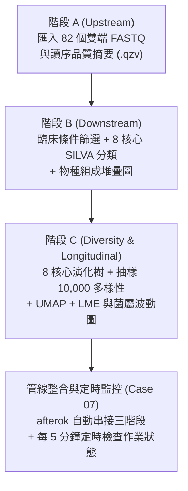

# 範例 3：管線派送與監控 —— 以 QIIME 2 腸道菌相分析為例 (Case 06 ~ Case 07)

在上一單元建立好 Nano4 Slurm Skill 後，本單元以真實臨床試驗（**NCT02269150：異體造血幹細胞移植病患接受自體糞菌移植 auto-FMT 之腸道菌相追蹤**）的 **QIIME 2 腸道菌相分析**為例，示範大型生醫管線的人機協同模式：

1. **AI 先說明腳本內容與資源設定**
2. **研究人員判斷並確認後，AI 才執行 `sbatch` 送出**
3. **送出後，AI 每 5 分鐘自動檢查一次作業狀態**，跑完後主動通知研究人員（不需人眼盯著螢幕，也不會每秒狂刷 `squeue` 癱瘓系統）



> [!TIP]
> **內建資料說明**：所需的 **82 個雙端 `.fastq.gz` 檔案、臨床 Metadata、預訓練 SILVA 138.2 分類器與上游特徵表** 均已放在 `data/qiime2/` 目錄中，不需執行 `wget` 下載。

---

## 🔹 階段 A：上游 82 個雙端 FASTQ 匯入與品質評估 (`Upstream`)

### 📋 請複製以下指令貼給 AI Agent：

```text
請參考 data/qiime2/Qiime2_Pipeline.sh 的第一段（上游前處理），幫我寫一支 Slurm 作業（計畫 GOV115088）送到計算節點執行，輸出結果請放在 tutorial/case06/qiime2_run/Upstream/：

1. 載入 biology/qiime2/2026.7 模組（不用再跑 wget 下載，資料已經在 data/qiime2/ 裡面了）。
2. 把 data/qiime2/Input_Data/data_to_import/ 裡面的 82 個雙端 FASTQ 檔案匯入成 demultiplexed-sequences.qza，並產生品質摘要圖 demultiplexed-sequences-summ.qzv。
3. 直接讀取現成的 data/qiime2/Upstream/feature-table-0.qza，產出特徵表摘要統計 feature-table-0-summ.qzv。
4. 送出前請先跟我說明腳本內容與資源設定，等我確認後才送出；送出後請每 5 分鐘自動檢查一次作業狀態，跑完後通知我。
```

*(註：中間 DADA2 去噪步驟對 41 個檢體運算通常需 30~60 分鐘以上，因此教材直接提供已算好的 `data/qiime2/Upstream/feature-table-0.qza`，讓本步驟約 2 分鐘即可完成。)*

---

## 🔹 階段 B：篩選臨床檢體與 8 核心菌種分類 (`Downstream`)

### 📋 請複製以下指令貼給 AI Agent：

```text
上一步成功了！接著請參考 data/qiime2/Qiime2_Pipeline.sh 的第三段前半部，幫我寫第二支 Slurm 腳本送到計算節點執行，結果放在 tutorial/case06/qiime2_run/Downstream/：

1. 直接讀取 data/qiime2/Input_Data/ 裡面現成的 sample-metadata.tsv、feature-table.qza、rep-seqs.qza 與 silva-138.2-ssu-nr99-515f-806r-classifier.qza 分類器（不需重新下載）。
2. 照腳本的條件篩選檢體（保留 autoFmtGroup 有值、移植前後 -10 到 70 天、至少出現在 2 個檢體、排除葉綠體與粒線體、總讀序數 >= 10,000）。
3. 完成菌種分類註解（請加上 --p-n-jobs 8 開啟 8 核心加速），並產生第一張物種組成堆疊圖 taxa-bar-plots-1.qzv。
4. 同樣請先向我說明腳本內容，確認後才送出，並設定每 5 分鐘自動檢查一次作業狀態（跑約 4 分鐘）。
```

---

## 🔹 階段 C：演化樹、核心多樣性、UMAP 與縱向統計 (`Diversity_Longitudinal`)

### 📋 請複製以下指令貼給 AI Agent：

```text
篩選跟分類都跑完了！現在請參考 data/qiime2/Qiime2_Pipeline.sh 後半段的多樣性與縱向分析，幫我送出第三支 Slurm 作業，結果放在 tutorial/case06/qiime2_run/Diversity_Longitudinal/：

1. 對上一步篩選後的序列建立演化樹（MAFFT / FastTree，請加上 --p-n-threads 8 用滿 8 核心）。
2. 以抽樣深度 10,000 計算 Alpha 與 Beta 核心多樣性指標、稀釋曲線與組間顯著性檢定。
3. 跑完 UMAP 降維、Emperor 排序圖，以及最後的線性混合效應模型（LME）與菌屬隨時間變化的波動圖（Volatility）。
4. 請先說明腳本內容，我確認後再送出，之後每 5 分鐘自動檢查一次作業狀態直到完成（跑約 8~9 分鐘）。
```

---

## 🔹 管線整合與定時監控 (`tutorial/case07`)：一鍵串接三階段自動化流水線

了解上述三個階段後，我們可以請 AI 將整套管線串成自動相依流水線（`--dependency=afterok`），並設定每 5 分鐘自動檢查進度：

### 📋 請複製以下指令貼給 AI Agent：

```text
太棒了！現在請幫我把上面三個階段（步驟 A 上游匯入、步驟 B 篩選與分類、步驟 C 多樣性與縱向分析）整合成一套完整的自動化 Slurm 流水線：
- 請幫我寫一個啟動腳本 run_full_qiime2_pipeline.sh，用 Slurm 的相依性功能（--dependency=afterok）把這三支腳本串起來，讓前一階段成功後自動啟動下一階段。
- 同時也幫我把 data/qiime2/Qiime2_Pipeline.sh 改寫成一份拿掉 wget、改讀本地 data/qiime2/ 資料，且符合 ngs62g（8 核心、62G 記憶體、module purge）規範的單一完整版 Qiime2_Pipeline_ngs62g.slurm 備用。
- 送出流水線前先跟我說明設定，我確認後再送出；送出後請每 5 分鐘自動檢查一次作業狀態，全部跑完後檢查所有 .qzv 結果檔是否都成功產生，並用白話文總結這次腸道菌相分析產出了哪些圖表！
- 腳本報告放在目前目錄 tutorial/case07
```

> [!IMPORTANT]
> **為什麼設定「每 5 分鐘自動檢查一次」，而不是用 `watch squeue`？**
> - 在登入節點使用 `watch -n 1 squeue` 或無窮迴圈每秒查詢，會對國網 Slurm 排程資料庫造成極大負擔（為 `AGENTS.md` 嚴格禁止事項）。
> - 透過 AI Agent 內建的定時排程工具（如 `schedule` 每 300 秒觸發一次單次 `squeue` / `sacct` 查詢），既能讓研究人員離開座位喝杯咖啡、跑完自動收到通知，又能保護叢集排程系統穩定運作。

---

## 💡 如何檢視產出的 `.qzv` 互動圖表？

1. 在 Antigravity 左側檔案總管展開 `tutorial/case06/qiime2_run/`。
2. 對任一 `.qzv` 檔案（如 `taxa-bar-plots-1.qzv`、`uu-umap-emperor-w-time.qzv`、`volatility-plot-1.qzv`）按**右鍵 → Download...** 下載至電腦。
3. 打開 **[https://view.qiime2.org](https://view.qiime2.org)**，將 `.qzv` 檔案拖曳進網頁即可互動檢視。

---

👉 管線執行完成後，請進入 **[範例 4：結果解讀與報告 —— 讓 AI 自動整理圖文報告並換上自己的研究資料](../05-automated-report-skill/README.md)**！
