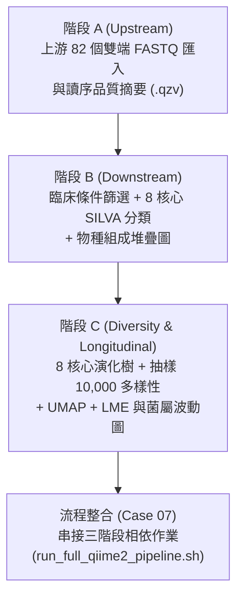

# 第 04 章：QIIME 2 腸道菌相分析 (Case 06 ~ Case 07)

本章使用 `data/qiime2/` 內建的臨床試驗資料集（**NCT02269150：異體造血幹細胞移植病患接受自體糞菌移植 auto-FMT 之腸道菌相追蹤**），與 AI Agent 協同執行 16S rRNA 腸道菌相分析流程。

所需之 **82 個雙端 `.fastq.gz` 檔案、臨床 Metadata、預訓練 SILVA 138.2 分類器與特徵表** 均已包含於 `data/qiime2/` 中，不需額外執行 `wget` 下載。我們將流程分為 3 個分析階段（A、B、C），最後再整合成單一自動化流程（Case 07）。



---

## 🔹 階段 A：上游 FASTQ 匯入與品質摘要 (`Upstream`)

### 📋 複製貼給 AI Agent 的指令：

```text
請參考 data/qiime2/Qiime2_Pipeline.sh 的第一段（上游前處理），幫我寫一支 Slurm 作業（計畫 GOV115088）送到計算節點執行，輸出結果請放在 tutorial/case06/qiime2_run/Upstream/：

1. 載入 biology/qiime2/2026.7 模組（不用再跑 wget 下載，資料已經在 data/qiime2/ 裡面了）。
2. 把 data/qiime2/Input_Data/data_to_import/ 裡面的 82 個雙端 FASTQ 檔案匯入成 demultiplexed-sequences.qza，並產生品質摘要圖 demultiplexed-sequences-summ.qzv。
3. 直接讀取現成的 data/qiime2/Upstream/feature-table-0.qza，產出特徵表摘要統計 feature-table-0-summ.qzv。
```

> [!NOTE]
> **關於 DADA2 去噪步驟說明**：
> 標準流程中，從 `demultiplexed-sequences.qza` 產生 `feature-table-0.qza` 需執行 `qiime dada2 denoise-paired`（對 41 個檢體約需 30~60 分鐘）。為節省上課等待時間，教材已預先提供計算好的 `data/qiime2/Upstream/feature-table-0.qza`，讓本階段可在 **約 2 分鐘** 內完成。

---

## 🔹 階段 B：臨床樣本篩選與物種分類註解 (`Downstream`)

### 📋 複製貼給 AI Agent 的指令：

```text
上一步成功了！接著請參考 data/qiime2/Qiime2_Pipeline.sh 的第三段前半部，幫我寫第二支 Slurm 腳本送到計算節點執行，結果放在 tutorial/case06/qiime2_run/Downstream/：

1. 直接讀取 data/qiime2/Input_Data/ 裡面現成的 sample-metadata.tsv、feature-table.qza、rep-seqs.qza 與 silva-138.2-ssu-nr99-515f-806r-classifier.qza 分類器（不需重新下載）。
2. 照腳本的條件篩選檢體（保留 autoFmtGroup 有值、移植前後 -10 到 70 天、至少出現在 2 個檢體、排除葉綠體與粒線體、總讀序數 >= 10,000）。
3. 完成菌種分類註解（請加上 --p-n-jobs 8 開啟 8 核心加速），並產生第一張物種組成堆疊圖 taxa-bar-plots-1.qzv。
```

- **協同執行內容**：開啟 `--p-n-jobs 8` 平行加速，約 **4 分鐘** 完成樣本篩選、SILVA 138.2 分類註解與物種堆疊圖。

---

## 🔹 階段 C：演化樹、核心多樣性與縱向統計 (`Diversity_Longitudinal`)

### 📋 複製貼給 AI Agent 的指令：

```text
篩選跟分類都跑完了！現在請參考 data/qiime2/Qiime2_Pipeline.sh 後半段的多樣性與縱向分析，幫我送出第三支 Slurm 作業，結果放在 tutorial/case06/qiime2_run/Diversity_Longitudinal/：

1. 對上一步篩選後的序列建立演化樹（MAFFT / FastTree，請加上 --p-n-threads 8 用滿 8 核心）。
2. 以抽樣深度 10,000 計算 Alpha 與 Beta 核心多樣性指標、稀釋曲線與組間顯著性檢定。
3. 跑完 UMAP 降維、Emperor 排序圖，以及最後的線性混合效應模型（LME）與菌屬隨時間變化的波動圖（Volatility）。
```

- **協同執行內容**：約 **8 分半鐘** 完成 MAFFT/FastTree 演化樹、Alpha/Beta 多樣性檢定、Emperor 排序圖、LME 模型與菌屬波動圖。

---

## 🔹 流程整合 (`tutorial/case07`)：串接三階段自動化 Slurm 流程

### 📋 複製貼給 AI Agent 的指令：

```text
太棒了！現在請幫我把上面三個階段（步驟 A 上游匯入、步驟 B 篩選與分類、步驟 C 多樣性與縱向分析）整合成一套完整的自動化 Slurm 流水線：
- 請幫我寫一個啟動腳本 run_full_qiime2_pipeline.sh，用 Slurm 的相依性功能（--dependency=afterok）把這三支腳本串起來，讓前一階段成功後自動啟動下一階段。
- 同時也幫我把 data/qiime2/Qiime2_Pipeline.sh 改寫成一份拿掉 wget、改讀本地 data/qiime2/ 資料，且符合 ngs62g（8 核心、62G 記憶體、module purge）規範的單一完整版 Qiime2_Pipeline_ngs62g.slurm 備用。
- 全部跑完後，請幫我檢查所有 .qzv 結果檔是否都成功產生，並用白話文總結這次腸道菌相分析產出了哪些圖表！
- 腳本報告放在目前目錄 tutorial/case07
```

---

## 💡 如何檢視 `.qzv` 視覺化圖表？

1. 在 Antigravity 左側檔案總管展開 `tutorial/case06/qiime2_run/`。
2. 對任一 `.qzv` 檔案按**右鍵 → Download...** 下載至個人電腦。
3. 開啟 **[https://view.qiime2.org](https://view.qiime2.org)**，將 `.qzv` 拖曳至網頁即可互動檢視圖表。

---

👉 完成後，請進入 **[第 05 章：產出分析報告](../05-automated-report-skill/README.md)**。
