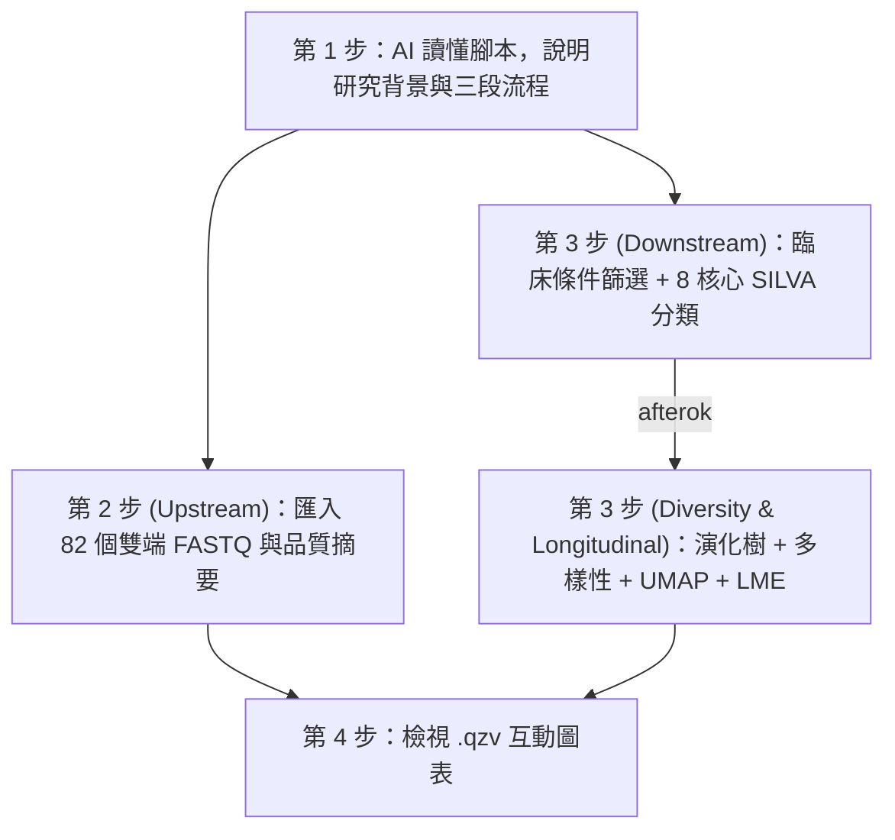

# 範例 3：管線派送與監控 —— 以 QIIME 2 腸道菌相分析為例 (Case 06 ~ Case 07)

在上一單元建立好 Nano4 Slurm Skill 後，本單元以真實臨床試驗（**NCT02269150：異體造血幹細胞移植病患接受自體糞菌移植 auto-FMT 之腸道菌相追蹤**）的 **QIIME 2 腸道菌相分析**為例，示範大型生醫管線的「**讀懂流程 ➔ 確認派送 ➔ 每 5 分鐘定時監控**」協同流程。

| 步驟 | 內容 | 預估時間 |
| :--- | :--- | :---: |
| **第 1 步** | [請 AI 讀懂分析腳本：研究背景與三段流程](#第-1-步請-ai-讀懂分析腳本研究背景與三段流程) | 3 分鐘 |
| **第 2 步** | [上游：82 個雙端 FASTQ 匯入與品質評估 (`Upstream`)](#第-2-步上游82-個雙端-fastq-匯入與品質評估) | 3 分鐘 |
| **第 3 步** | [下游：篩選分類 ➔ 多樣性分析，用 `afterok` 串接一次送出](#第-3-步下游篩選分類--多樣性分析用-afterok-串接一次送出) | 13 分鐘 |
| **第 4 步** | [等待時下載並檢視 `.qzv` 互動圖表](#第-4-步等待時下載並檢視-qzv-互動圖表) | 與第 3 步同時進行 |
| **選做** | [整合成單一完整版 Slurm 腳本 (`Case 07`)](#選做整合成單一完整版-slurm-腳本) | 課後 |



> [!NOTE]
> **QIIME 2 是什麼？**
> QIIME 2 是微生物菌相分析最常用的開源平台，從 16S rRNA 擴增子定序資料出發，完成去噪、物種分類、多樣性與統計分析。它的檔案分兩種：
> - **`.qza`**（資料檔）：序列、特徵表、演化樹等中間結果，並記錄完整的分析來源。
> - **`.qzv`**（圖表檔）：拖進 [view.qiime2.org](https://view.qiime2.org) 即可互動檢視。
>
> 本單元不需要記住 QIIME 2 指令，讓 AI 讀懂教材腳本、改寫成 Slurm 作業即可。

> [!TIP]
> **內建資料說明**：所需的 **82 個雙端 `.fastq.gz` 檔案、臨床 Metadata、預訓練 SILVA 138.2 分類器與上游特徵表** 均已放在 `data/qiime2/` 目錄中，不需執行 `wget` 下載。

> [!TIP]
> **想試試您在範例 2 建立的 Skill？** 在 Prompt 開頭加上「請使用 my-nano4-slurm」即可；不加則使用教材內建的 `nano4-ngs-slurm`。

---

## 第 1 步：請 AI 讀懂分析腳本：研究背景與三段流程

### 📋 請複製以下指令貼給 AI Agent：

```text
請閱讀 data/qiime2/Qiime2_Pipeline.sh（先不要送出任何作業），用白話文告訴我：
1. 這份資料的研究背景，以及想回答什麼問題。
2. 流程分成哪幾段、各段的輸入與產出，以及哪些段落彼此相依。
3. 預計會產生哪些 .qzv 圖表，各自可以看出什麼。
```

AI 會發現腳本註明「**上游與下游兩段不承接**」：上游用 41 個檢體示範資料匯入，下游改用另一批已整理好的特徵表做分析。因此接下來上游單獨送出，下游的兩個階段才需要用 `afterok` 串接。

---

## 第 2 步：上游：82 個雙端 FASTQ 匯入與品質評估

### 📋 請複製以下指令貼給 AI Agent：

```text
請參考 data/qiime2/Qiime2_Pipeline.sh 的上游段落，寫一支 Slurm 作業送到計算節點，結果放在 tutorial/case06/qiime2_run/Upstream/：
1. 載入 biology/qiime2/2026.7 模組（資料已在 data/qiime2/，不需 wget）。
2. 把 data/qiime2/Input_Data/data_to_import/ 的 82 個雙端 FASTQ 匯入成 demultiplexed-sequences.qza，並產生品質摘要圖 demultiplexed-sequences-summ.qzv。
3. 讀取現成的 data/qiime2/Upstream/feature-table-0.qza，產出 feature-table-0-summ.qzv。
送出後每 5 分鐘檢查一次狀態，跑完通知我。
```

*(註：中間 DADA2 去噪步驟對 41 個檢體運算通常需 30~60 分鐘以上，因此教材直接提供已算好的 `data/qiime2/Upstream/feature-table-0.qza`，讓本步驟約 2 分鐘即可完成。)*

---

## 第 3 步：下游：篩選分類 ➔ 多樣性分析，用 afterok 串接一次送出

多樣性分析要用到篩選後的序列，兩者有真正的前後相依，因此用 `--dependency=afterok` 一次送出，第一支成功後第二支自動開始。

### 📋 請複製以下指令貼給 AI Agent：

```text
請參考 data/qiime2/Qiime2_Pipeline.sh 的下游段落，寫兩支 Slurm 腳本，用 --dependency=afterok 串接後一次送出（同樣載入 biology/qiime2/2026.7）：
1. 篩選與分類，結果放在 tutorial/case06/qiime2_run/Downstream/：
   - 讀取 data/qiime2/Input_Data/ 的 sample-metadata.tsv、feature-table.qza、rep-seqs.qza 與 silva-138.2-ssu-nr99-515f-806r-classifier.qza。
   - 照腳本條件篩選檢體（autoFmtGroup 有值、移植前後 -10 到 70 天、至少出現在 2 個檢體、排除葉綠體與粒線體、總讀序數 >= 10,000）。
   - 菌種分類加上 --p-n-jobs 8，並產生物種組成堆疊圖 taxa-bar-plots-1.qzv。
2. 多樣性與縱向分析，結果放在 tutorial/case06/qiime2_run/Diversity_Longitudinal/：
   - 用第 1 支篩選後的序列建立演化樹（MAFFT / FastTree，加上 --p-n-threads 8）。
   - 以抽樣深度 10,000 計算 Alpha 與 Beta 多樣性、稀釋曲線與組間顯著性檢定。
   - 跑 UMAP、Emperor 排序圖、線性混合效應模型（LME）與菌屬波動圖（Volatility）。
送出後每 5 分鐘檢查一次狀態（全部約 13 分鐘），跑完後確認所有 .qzv 都有產生，並用白話文說明產出了哪些圖表。
```

> [!IMPORTANT]
> **為什麼設定「每 5 分鐘檢查一次」，而不是用 `watch squeue`？**
> - 在登入節點用 `watch -n 1 squeue` 或迴圈每秒查詢，會對國網 Slurm 排程資料庫造成極大負擔（`AGENTS.md` 禁止事項）。
> - 低頻定時查詢一次 `squeue` / `sacct`，既能讓您離開座位、跑完收到通知，又能保護叢集穩定運作。
> - **若您使用的 Agent 不支援定時檢查**，可以隨時問 AI「作業跑完了嗎？」，或自行執行一次 `sacct -u $USER -S today`。

---

## 第 4 步：等待時下載並檢視 qzv 互動圖表

第 3 步約需 13 分鐘，可以先看第 2 步已完成的上游圖表：

1. 在 Antigravity 左側檔案總管展開 `tutorial/case06/qiime2_run/Upstream/`。
2. 對 `demultiplexed-sequences-summ.qzv` 按**右鍵 → Download...** 下載至電腦。
3. 打開 **[https://view.qiime2.org](https://view.qiime2.org)**，將 `.qzv` 檔案拖曳進網頁即可互動檢視讀序品質。

第 3 步跑完後，再用同樣方式檢視 `Downstream/taxa-bar-plots-1.qzv`（物種組成）與 `Diversity_Longitudinal/` 裡的 UMAP、波動圖等結果，並對照第 1 步 AI 說明的「各圖表可以看出什麼」。

---

## 選做：整合成單一完整版 Slurm 腳本

課堂上已分段跑完全部流程。若想留一份日後可直接重跑的版本，可請 AI 產生整合腳本（課後再送出即可，不必在課堂重跑）：

```text
請把 data/qiime2/Qiime2_Pipeline.sh 改寫成一份拿掉 wget、改讀本地 data/qiime2/ 資料，且符合 ngs62g 規範的單一完整版 Qiime2_Pipeline_ngs62g.slurm，放在 tutorial/case07。先不要送出。
```

---

👉 管線執行完成後，請進入 **[範例 4：結果解讀與報告 —— 讓 AI 整理圖文報告，並換上自己的研究資料](../05-automated-report-skill/README.md)**！
